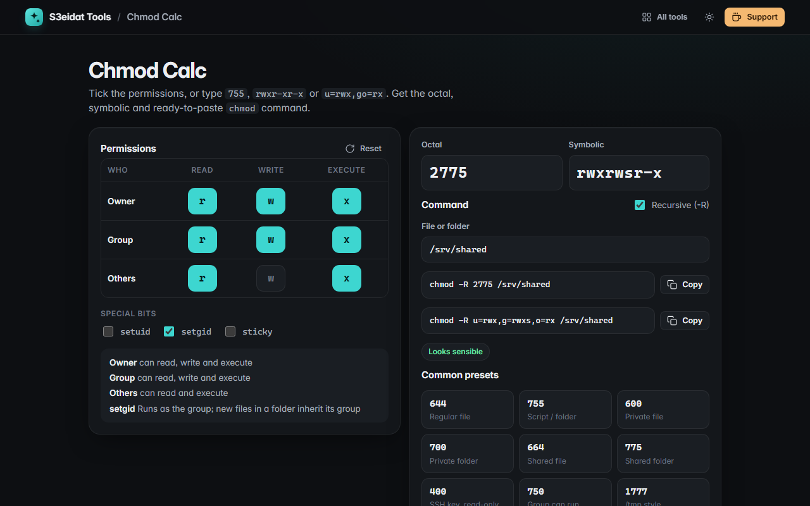

# Chmod Calc

> Unix permission calculator: tick boxes or type `755`, `rwxr-xr-x` or `u=rwx,go=rx`. Free, private, and it runs entirely in your browser.

### ▶ [Open Chmod Calc](https://s3eidat.github.io/chmod-calc/)



## Features

- **Checkbox grid** for owner / group / others × read / write / execute
- **Special bits**: setuid, setgid and sticky, shown as `s`/`S` and `t`/`T` exactly like `ls -l`
- Type **octal** (`644`, `0755`, `4755`) or **symbolic** (`rw-r--r--`, `-rwsr-xr-x`, or clauses like `u=rwx,g+w,o-r`) and the grid follows
- Ready-to-paste **`chmod` commands** in both octal and symbolic form, optional `-R`, safe shell quoting of the file name
- **Plain-English summary** of who can do what, plus warnings for world-writable or risky setuid modes
- 12 **common presets** (644, 755, 600, 1777, 2775, …)
- Remembers your last mode

## Privacy

Nothing you type leaves your device. There is no server, no account, no analytics.
The page ships with a strict Content-Security-Policy (`connect-src 'self'`), so the browser
itself blocks any attempt to send data anywhere.

## Run it yourself

It's plain HTML, CSS and JavaScript with no build step:

```bash
git clone https://github.com/s3eidat/chmod-calc
cd chmod-calc
python -m http.server 8000
```

Then open http://localhost:8000.

## Support

If this saved you time, **[buy me a coffee ☕](https://s3eidat.github.io/coffee/)**. It keeps every tool free.

---

Part of **[S3eidat Tools](https://s3eidat.github.io/)**: 100+ free, private tools that run in your browser. MIT licensed.
